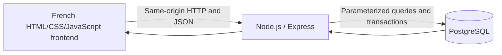

# Architecture and development

## Request flow



`server/index.js` loads configuration, checks database initialization, creates the Express app, and listens for HTTP requests. It closes the server and connection pool on shutdown. `server/app.js` registers security headers, JSON parsing, rate limits, session lookup, mutation protection, and the API routes. Static files are served only from `dist/`.

## Backend responsibilities

| Module | Responsibility |
| --- | --- |
| `server/config.js` | Environment validation and the agency's calendar date |
| `server/db.js` | Connection pool and a transaction helper using one client per transaction |
| `server/security.js` | scrypt password hashes, random session tokens, cookie settings, CSRF/origin checks, and role validation |
| `server/validation.js` | Strict JSON request schemas and French error messages |
| `server/routes/auth.js` | Member registration, login, and logout |
| `server/routes/data.js` | Session-scoped bootstrap data for the frontend |
| `server/routes/rentals.js` | Booking creation, server pricing, and cancellation |
| `server/routes/admin.js` | Car editing/removal and member suspension/deletion |
| `server/queries.js` | Consistent rental fields and JSON aliases |
| `server/migrate.js` | Ordered migrations with recorded checksums |
| `server/seed.js` | Initial administrator and sample cars without resetting existing records |

The API never trusts a client-supplied role, member ID, or rental total. Every protected mutation checks the authenticated account. Critical mutations recheck the account under a row lock so a suspension/deletion cannot race with a booking.

## Frontend responsibilities

| Module | Responsibility |
| --- | --- |
| `dist/app.js` | Initialize page controls and load bootstrap data |
| `dist/js/api.js` | Same-origin JSON requests and in-memory CSRF token |
| `dist/js/store.js` | In-memory server data and availability/display helpers |
| `dist/js/auth.js` | Account, login, and sign-up dialogs |
| `dist/js/collection.js` | Car cards, agency/category/date filters, sorting |
| `dist/js/rentals.js` | Booking summaries, rental history, cancellation dialogs |
| `dist/js/admin.js` | Backoffice tables and management forms |
| `dist/js/router.js` | Hash navigation and account status in the header |
| `dist/js/events.js` | User actions and refresh on tab focus |
| `dist/js/ui.js` | Dialogs, confirmations, and toast notifications |
| `dist/js/labels.js` | French labels for stable stored values |
| `dist/js/utils.js` | Escaping, dates, numbers, icons, and image URLs |

The browser uses native JavaScript modules. It does not store account passwords, session tokens, or bookings in local storage. HttpOnly session cookies are sent automatically to the same origin. Bootstrap data is refreshed after changes and when the tab regains focus; booking conflicts are always rechecked by the server.

## Booking rules

- A rental lasts **1–365 days** and cannot start before the agency's current date.
- The date interval is `[start, end)`: the return date is exclusive. Two rentals may meet on the same boundary date.
- The server reads the current vehicle rate. PostgreSQL calculates the total from that booked daily rate and the number of days.
- The rental stores snapshots of the car name/image, member name/email, location, and daily rate.
- Member/car row locks serialize critical changes. A PostgreSQL GiST exclusion constraint independently rejects overlapping confirmed rentals, including direct SQL writes.
- Members may cancel their own rentals before the pick-up date. Administrators may cancel active rentals, including rentals already in progress.
- A car with an active reservation cannot be removed until its active reservations are cancelled.
- Cars and members are soft-deleted. Deleting a member cancels active reservations; suspending one preserves existing reservations while revoking their sign-in sessions.
- The displayed `completed` status is derived from the return date. It is not another stored rental status.

## Local development

```sh
npm run db:start
npm run dev
```

Edit HTML/CSS/JS under `dist/` and server code under `server/`. Refresh the browser after frontend changes; Node's watch mode restarts the backend after server changes.

Change database schemas through a new SQL file in `server/migrations/`, then run `npm run db:migrate`. See [DATABASE.md](DATABASE.md). Keep business rules on the server; hiding controls in the frontend is not an authorization boundary.

## Verification

| Command | What it verifies |
| --- | --- |
| `npm test` | Account/session security, authorization, French errors, CSRF, pricing, booking conflicts, admin/member operations, persistence, rate limits |
| `npm run test:db` | Migration checksums, email uniqueness, check constraints, foreign keys, generated totals, concurrent SQL conflicts, session cascades, rollback, persistence |
| `npm run test:ui` | French public/member/admin screens, sign-up/sign-in, filters, booking/cancellation, car/member controls, responsive widths |

Each suite creates and owns a randomly named `vellum_test_*` schema. Only that schema is removed at teardown. Browser tests start their own HTTP server on an available port, so the normal application can stay running. Screenshots are written under ignored `test-results/`.

The GitHub workflow provisions a fresh PostgreSQL service, installs locked dependencies and Chromium, and runs all three suites. It does not use the developer's `.env` or local database.
