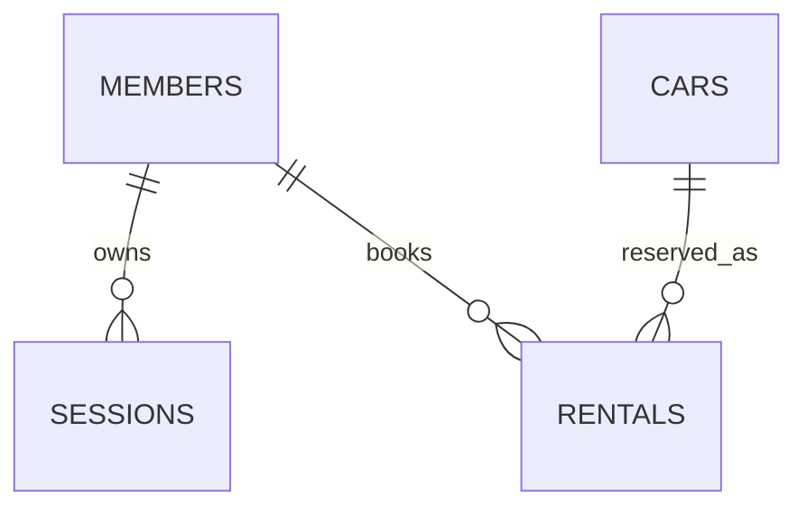

# Database, migrations, and transferring data

## Data model



| Table | Purpose |
| --- | --- |
| `members` | Names, normalized email addresses, password hashes, roles, suspension/deletion state |
| `sessions` | Hashed random session tokens, CSRF tokens, member references, expiry dates |
| `cars` | Vehicle details, daily rates, agency, image, and archive state |
| `rentals` | Dates, member/car references, snapshots, booked daily rate, generated total, cancellation state |
| `schema_migrations` | Applied migration filenames, checksums, and timestamps |

The initial migration is `server/migrations/001_initial.sql`. It enables `btree_gist` and defines a GiST exclusion constraint over car IDs and date ranges. Confirmed rentals for the same car cannot overlap, even if an insert bypasses the API. The generated `total` is `daily_rate * (end_date - start_date)`.

Car/member references protect rental history from hard deletion. Application endpoints instead archive cars and soft-delete members. Sessions use a cascading member foreign key. Active member emails are unique; a soft-deleted email can be used by a new account.

## Migrations

```sh
npm run db:migrate
```

Migrations run in filename order and record a SHA-256 checksum. Repeating the command skips matching applied files. Editing an applied migration causes an error; add a new file such as `002_add_vehicle_field.sql` instead.

All statements in a migration run on one PostgreSQL transaction/client. `.gitattributes` fixes source text line endings to LF so Windows and Unix checkouts calculate the same SQL checksum.

`npm run db:seed` inserts missing initial car IDs and the configured initial administrator. It preserves existing records and passwords. It will not promote an existing normal member with the same `ADMIN_EMAIL` to administrator.

## Inspect with SQL Shell or pgAdmin

Native local connection settings:

| Setting | Value |
| --- | --- |
| Host | `127.0.0.1` |
| Port | `55432` by default; see your `DATABASE_URL` if customized |
| Database | `vellum` |
| Username | `vellum_app` |
| Password | Database password from the local `DATABASE_URL` |

In pgAdmin, register a **new server connection** using these settings, then expand **Databases → vellum → Schemas → public → Tables**. An existing connection to port 5432 will show a different instance.

If PostgreSQL's `bin` directory is on `PATH`, connect with:

```sh
psql -h 127.0.0.1 -p 55432 -U vellum_app -d vellum -W
```

The `-W` prompt requests the database password. Inside psql:

```sql
\conninfo
\dt
SELECT id, name, category, price, archived FROM cars;
SELECT reference, start_date, end_date, total, status FROM rentals;
\q
```

## Moving to a new computer

There are two distinct workflows:

1. **Fresh data:** clone the repository and follow [SETUP.md](SETUP.md). This creates six sample cars and a new administrator.
2. **Existing data:** clone the source, initialize the new computer's PostgreSQL roles/server, then use a private logical backup and restore into an empty database as described below.

Never commit a database backup or `.env` to GitHub. Do not copy the raw `.local/postgres/` cluster directory between computers or PostgreSQL major versions. Logical dumps are the portable transfer format; see the official [pg_dump](https://www.postgresql.org/docs/current/app-pgdump.html) and [pg_restore](https://www.postgresql.org/docs/current/app-pgrestore.html) documentation.

### Export from the original computer

Stop automated tests before exporting, so their temporary schemas are not included. Ensure PostgreSQL tools matching the server version are installed and available on `PATH`. On Windows, this may be:

```powershell
$env:PATH = "C:\Program Files\PostgreSQL\18\bin;$env:PATH"
New-Item -ItemType Directory -Force .local/backups | Out-Null
```

On macOS/Linux, use `mkdir -p .local/backups`.

```sh
pg_dump -h 127.0.0.1 -p 55432 -U vellum_app -d vellum -W --format=custom --file=.local/backups/vellum.dump
```

Enter the database password at the prompt. The dump contains personal records and password/session hashes. Transfer it privately to the destination computer, outside Git. The `.local/` directory and `*.dump`/`*.backup` files are ignored.

### Restore into a new empty database

On the destination machine, first complete native database setup or provision an equivalent PostgreSQL server with the `vellum_app` login. This gives the new machine its own application database password.

Use the destination cluster's administrator connection to create a separate, empty destination database:

```sql
CREATE DATABASE vellum_restored OWNER vellum_app;
```

For the native helper's cluster, its PostgreSQL administrator login is `postgres` and its generated cluster password is `adminPassword` in that computer's private `.local/postgres.json`. This is different from the website administrator password. Other PostgreSQL installations use their own administrator credentials.

Restore into that empty database:

```sh
pg_restore -h 127.0.0.1 -p 55432 -U vellum_app -d vellum_restored -W --no-owner --no-privileges --single-transaction --exit-on-error /path/to/vellum.dump
```

Replace the file path and connection settings as appropriate. Avoid restoring onto a database that already contains application tables. The no-owner/no-privileges options let the destination login own restored objects without importing source-cluster roles and grants.

Update the destination `.env` so `DATABASE_URL` uses `/vellum_restored` and the **destination database password**, then run:

```sh
npm run db:migrate
npm start
```

Existing website accounts retain the password hashes from the original database: sign in with their original website passwords. The new checkout's generated `ADMIN_PASSWORD` does not overwrite a restored account.

If you want to invalidate restored login sessions, connect specifically to the restored database and run `DELETE FROM sessions;` before starting the app. This signs users out while retaining accounts and reservations.

## Tests

```sh
npm run test:db
```

Direct SQL tests cover migration integrity, email uniqueness, vehicle constraints, foreign keys, generated totals, invalid dates, concurrent bookings, session cascades, rollback, and reconnect persistence. API/browser suites also exercise a real PostgreSQL database.

The test login needs schema-creation privileges. Each run owns a unique `vellum_test_*` schema, which is dropped during cleanup. Normal application data is not reset.
